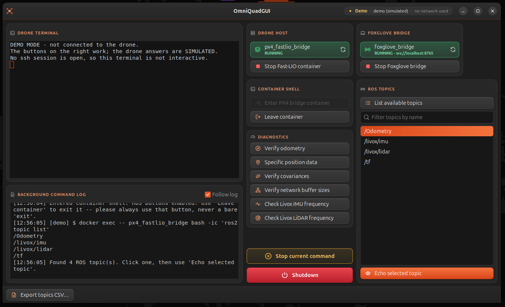

# OmniQuadGUI

A desktop app for **Ubuntu (22.04 / 24.04)** that connects over SSH to the
onboard computer of a drone (Radxa Rock 5B, ROS 2, Docker) for container
and ROS diagnostics, with an embedded terminal, container management and
ROS topic tools.



**It does not control flight.** It cannot arm, steer or land the drone. What
it can do is read data from the drone remotely, **also while it is flying**:
listing and echoing ROS topics, the diagnostics checks and the bridge status
only read data on the onboard computer.

During a flight, do **not** use *Stop Fast-LIO container* or *Shutdown*: they
stop the odometry bridge or power off the onboard computer the flight depends
on. Use them only with the drone on the ground.

---

## Install on Ubuntu

On a fresh Ubuntu desktop (tested style: 22.04 / 24.04), open a normal
terminal and run:

```bash
sudo apt update
sudo apt install python3-gi gir1.2-gtk-3.0 gir1.2-vte-2.91 sshpass \
    openssh-client
```

| Package              | What it is for                                            |
|----------------------|-----------------------------------------------------------|
| `python3`            | Python 3 itself (installed automatically with `python3-gi`) |
| `python3-gi`         | Lets Python use GTK (the graphical toolkit)               |
| `gir1.2-gtk-3.0`     | GTK 3 itself                                              |
| `gir1.2-vte-2.91`    | The embedded terminal widget (like GNOME Terminal's core) |
| `gir1.2-pango-1.0`   | Text rendering (fonts) — installed automatically together with `gir1.2-gtk-3.0` |
| `gir1.2-gdk-pixbuf-2.0` | Loading the logo image — installed automatically together with `gir1.2-gtk-3.0` |
| `librsvg2-common`    | Draws the SVG button icons and the rotor loading animation. Already part of every Ubuntu desktop; without it the buttons simply show text only and a plain spinner is used |
| ROS 2 + `ros-<distro>-foxglove-bridge` | Only for the **local Foxglove bridge** (see below), e.g. `sudo apt install ros-jazzy-foxglove-bridge`. Everything else works without ROS on this PC |
| `sshpass`            | Feeds the SSH password without showing it on screen       |
| `openssh-client`     | The `ssh` program itself (used for every connection; installed automatically on Ubuntu, listed here so nothing is missing) |

The app itself uses **only the Python standard library** (json, os,
subprocess, threading, …) plus the GTK/VTE libraries above — there is
**nothing to install with `pip`**.

Ubuntu's package manager installs `gir1.2-pango-1.0`,
`gir1.2-gdk-pixbuf-2.0` and `openssh-client` automatically as
dependencies of the packages above, so the short `apt install` line is
enough — the table simply shows the complete list of libraries the app
touches.

On the drone side, SSH must be enabled and the user (default `rock`) must be
allowed to log in with a password.

## Run on Ubuntu

```bash
cd OmniQuadGUI
python3 main.py
```

or double-click **`OmniQuadGUI.desktop`** inside the folder in the file
manager (right-click it once and choose **Allow Launching** first).
The launcher resolves the application path relative to its own folder
and uses Ubuntu's system Python, so the folder (including `launch.sh`) can
be copied to any PC, for any user, to any location. On the first start
`launch.sh` copies the app icon into the user's private icon folder, so
the icon shows up in the file manager and the taskbar from then on.
From a terminal, use `./launch.sh` (or `python3 main.py`) from this
directory; `launch.sh` resolves the application path itself.

The app also cleans ROS 2 leftovers (from a sourced `setup.bash`) out of
its own environment at startup, so it behaves the same whether it is
started from the launcher, from `launch.sh`, or from a terminal that has
ROS sourced.

- **Start window:** type the drone's IP (e.g. `192.168.1.50`), the user
  (default `rock`) and the password, then click **Connect**.
- If the connection fails you get a plain-English message, for example
  *"wrong password"* or *"could not reach the drone — check it is powered
  on and both machines are on the same network"*.
- On success the main window opens with the drone's terminal embedded.

### Demo view (no drone needed)
Click **Open offline demo**, or log in with the **demo credentials** (default: user `demo`, password
`demo`, both changeable in `config.json`). The GUI opens normally —
the header bar shows an amber **Demo** status — but:

- no SSH session is opened and no drone is contacted anywhere;
- the terminal only shows a demo banner (it is not interactive);
- all buttons work against **simulated drone answers**: the bridge
  status starts as *running*, Start/Stop/shutdown run their full
  sequences with a small pretend state, and the log area fills as
  usual. Perfect for trying the GUI before the drone is on your desk.

The app remembers the user and host after a successful SSH check. These two
fields are stored in `$XDG_STATE_HOME/OmniQuadGUI/connection.json` (default
base `~/.local/state`). Removing this file restores the defaults from the repo.
To open the demo directly, run `python3 main.py --demo`.
Login passwords stay in memory.

After an SSH disconnect, the terminal and last results stay visible.
Choose **Reconnect** to return to the login window. **Export topics CSV**
saves the displayed topics, including after disconnect.

## Files and configuration

| File              | Purpose                                                        |
|-------------------|----------------------------------------------------------------|
| `main.py`         | Starts the app in a clean environment (see above).  |
| `gtk_app.py`      | The interface: VTE terminal, container management and ROS tools. |
| `ui_theme.py`     | Ubuntu look and feel: dark theme (CSS), icon loading, button/card helpers and the rotor loading animation. |
| `local_bridge.py` | Starts, watches and stops the local Foxglove bridge (runs on this PC, not on the drone). |
| `diagnostics.py`  | Settings, command definitions, topic parsing and CSV export. |
| `config.json`     | Shared defaults for user, IP, demo credentials and `dry_run`. |
| `commands.json`   | The button definitions (labels, icons + commands). Data only.  |
| `images/`         | The app logo: `omniquadgui.png` (login background, window + shortcut icon) and `omniquadgui.svg` (vector source of the PNG); `OmniQuadGUI_screenshot.png` (the main window in demo mode, shown at the top of this README). |
| `images/icons/`   | The button icons (simple SVG line drawings, one file each). They draw in `currentColor`, which the app replaces with the colour each button needs. |
| `launch.sh`       | Portable launcher script used by `OmniQuadGUI.desktop`; finds its own folder, installs the icon once, then starts the app. |
| `OmniQuadGUI.desktop` | The double-clickable launcher icon inside the folder (portable: no user name or absolute path). |
| `PROGRESS.txt`    | Handoff/progress notes for continuing development on the app. |
| `README.md`       | This file.                                                     |

`config.json` looks like this:

```json
{
    "user": "rock",
    "ip": "",
    "dry_run": true,
    "demo_user": "demo",
    "demo_password": "demo",
    "ros_setup": ""
}
```

- `user` — the login name on the drone.
- `ip` — initial host when there is no saved connection for this user.
- `dry_run` — leave `true` for now: the Shutdown button will
  *print what it would run* instead of actually shutting the drone down.
- `demo_user` / `demo_password` — login that opens the GUI in demo mode
  (no drone connection, simulated answers). Not a security feature —
  just a preview mode.
- `ros_setup` — only for the local Foxglove bridge: the ROS `setup.bash`
  to use if `ros2` is not already set up by your `~/.bashrc`. Leave it
  empty to find it automatically in `/opt/ros/`.

## How SSH works on Ubuntu

1. When you click **Connect**, the app first runs a quick non-interactive
   check: `sshpass -e ssh rock@<ip> echo ok`.
   - `sshpass -e` reads the password from the `SSHPASS` environment
     variable, so the password is **never on a command line** and is
     **never written to disk or logs**.
   - If this check prints `ok`, the IP, password and host key are all good.
2. Then the app opens the real interactive session inside the embedded
   terminal:
   `sshpass -e ssh -o ControlMaster=yes -o ControlPath=<socket>
   -o StrictHostKeyChecking=accept-new rock@<ip>`
   - `ControlMaster=yes` + `ControlPath=<socket>` make this one session the
     **master connection**. It stays open as long as the app window is open.
   - Because the check already verified the password, this session logs in
     silently — no second password prompt.
3. Every button that needs to *read* something from the drone
   (bridge status, safety checks, topic list) runs its own short, non-interactive
   `ssh -o ControlPath=<socket> rock@<ip> "<command>"`. That reuses the
   master connection through the socket file, so **no password is needed
   again**. The GUI never freezes while these run: they happen in a
   background thread, and the window is only updated when the result is
   ready.
4. The socket lives in a private temporary folder that the app deletes
   when you close the window. Closing the window also politely closes the
   master SSH connection.

The terminal itself always stays visible: buttons that you "watch live"
simply type their command into that terminal, exactly as if you had typed it.

## Host controls on Ubuntu

The **Drone host** card (top right) holds the bridge status and the
Start/Stop button, Shutdown sits at the bottom of the shell column (all
built from `commands.json`), and the **left half** of the window is split 50/50 (drag the divider to
change it): the terminal on top, and below it the small
**Background command log** — every command the app runs remotely, and
its output, is appended there with a timestamp. The on-screen log keeps
the most recent 5,000 lines, up to 512,000 characters. Clear **Follow log**
to read older entries while output arrives. Select it again to jump to the latest entry. The buttons
themselves never freeze the window — the ssh commands run in background
threads and reuse the master connection
(`ssh -o ControlPath=<socket> rock@<ip> "<command>"`), so no password is
typed a second time.

Pasting into the terminal: **right-click → Paste**, or the keyboard
shortcut **Ctrl+Shift+V** (plain Ctrl+V does nothing in terminals —
that is normal). Copy is right-click → Copy or Ctrl+Shift+C.

### Bridge status
The **Drone host** card shows one status label for the
`px4_fastlio_bridge` container: **green** with normal text while it
runs, **red** with grey text while it does not, plain grey when the
state is unknown (not checked yet, or the check failed). The app checks
automatically after connecting and after every start/stop; the small
**refresh** arrow inside the label checks again by hand (it turns into
the spinning rotor while checking). The check runs `docker ps`
**without sudo**. If the user (e.g. `rock`) is not allowed to use
docker, you get a clear explanation with the exact
`sudo usermod -aG docker rock` command to fix it on the drone.

### Start / Stop button
A single button under the label: it shows **Start Fast-LIO container**
while the bridge is stopped and **Stop Fast-LIO container** while it
runs. When the state is unknown it shows a disabled *Start* — refresh
first, so the app never starts the bridge blind.

**Start** runs `./nuc_helper.sh run --mode run_nodes --config ~/mid360_custom.yaml`
in the drone's home directory, logs the result and checks the status again.

**Stop** runs the safe sequence:
1. Checks with `docker ps` whether `px4_fastlio_bridge` is running at all.
   If not: reports "already stopped" and does nothing else.
2. If you had entered the container shell with the app's own button,
   it first sends Ctrl+C, waits 0.5 s and types `exit` — the
   app only ever sends a bare `exit` when it knows you are inside the
   container, because otherwise it would close the whole ssh session.
3. Runs `./nuc_helper.sh stoprm`. An error here is not fatal by itself.
4. Verifies with `docker ps` that the container is really gone and
   reports the result.

### Shutdown (two clicks)
- First click **arms** it: the button is replaced by
  **Confirm shutdown** / **Cancel**.
- **Confirm shutdown** always runs the stop sequence (steps 2–4 above),
  even if the container looked stopped.
- SAFETY-CRITICAL: if the verification shows the container still
  running, or the check itself fails, the shutdown is **aborted** with a
  loud warning popup. The drone keeps running.
- Only when the container is verified stopped, the app runs
  `sudo -S -p '' shutdown now`, sending the login password through the
  ssh process's standard input (never in the command text, never in the
  log). If SSH acknowledges the command, the controls are disabled.
  If the connection drops before SSH returns success, the GUI reports that
  shutdown could not be confirmed.

### dry_run (default ON)
With `"dry_run": true` in `config.json`, everything above happens
normally (stopping the container, verification) **except** the final
`sudo shutdown`: the log prints exactly what it *would* have run.
Set `"dry_run": false` in `config.json` only when you really want the
drone to shut down from the app.

## Local Foxglove bridge

The **Foxglove bridge** card (top row, next to *Drone host*) controls a
program that runs on **this computer**, not on the drone:
`ros2 launch foxglove_bridge foxglove_bridge_launch.xml` (defined in the
`local_bridge` section of `commands.json`).

- It **starts together with OmniQuadGUI** (already at the login window,
  `"autostart": true`) and keeps running across *Reconnect*. When you close
  the program, it is stopped cleanly (Ctrl+C first, harder only if needed).
  This also happens when the program is ended with `kill` or its terminal
  is closed.
- If a bridge is **already running** when it starts (for example after
  the program crashed, or one started by hand in a terminal), that bridge
  is stopped first and a fresh one is started. This only touches bridges
  of your own user; the log shows which PIDs were restarted.
- The status label is green (**RUNNING · ws://localhost:8765**, the address
  to open in Foxglove) or red (**NOT RUNNING**), and one button starts or
  stops it. This card stays usable even without a drone connection.
- The **refresh button** on the label checks the bridge again and writes
  what it found to the log: running and listening on port 8765; started but
  the port is not open (yet); a bridge **not started by this app** is
  running (grey label *RUNNING, NOT STARTED HERE*; press *Start* to restart
  it from the app); or the port is taken by another program. The check
  only looks; it never connects to the bridge or changes anything.
- Its output appears in the **Background command log** with the prefix
  `[foxglove]` (including what it printed before the main window opened).
  Common problems come with a tip: bridge not installed, ROS not found, or
  port 8765 already in use by a different program or another user.
- ROS setup: the app itself runs without ROS (that keeps the window from
  freezing), so the bridge is started through `bash -i`, which reads your
  `~/.bashrc` — the same ROS setup (and `ROS_DOMAIN_ID`) as in a normal
  terminal. If `ros2` is still not found, `/opt/ros/<distro>/setup.bash` is
  used (or `ros_setup` from `config.json`).
- Note: `foxglove_bridge` listens on **all network interfaces** by default
  (`0.0.0.0:8765`), so other computers on the same network can connect to
  it too.

## Container shell and ROS controls on Ubuntu

The right side of the window is made of rounded cards:

- **Drone host** at the top left: the bridge status label (with its
  refresh button) and the Start/Stop button. The rest of the top row is
  free for now.
- Below it, on the left: **Container shell** (enter / leave),
  **Diagnostics** (the fixed ROS checks), the big amber-outlined
  **Stop current command**, and under it **Shutdown** (which turns into
  *Confirm shutdown* + a cancel button after the first click).
- Below it, on the right, with the most room: **ROS topics** (List
  available topics, the filter, the topic list and Echo selected topic,
  top to bottom in the order you use them).

The theme is centred on Ubuntu orange. Every button shows an icon next
to its text. Colours carry meaning: orange = the main action of a group,
red = shutdown, amber outline = stop the running command (Start/Stop
container look like normal buttons with a green / red icon). While
something loads, a small spinning **rotor** appears in the card title
(and next to the status text in the connect window).

The header bar shows a thin **connection status** strip: a dot and a
word (green *Connected*, amber *Connecting…*/*Demo*, red *No response*
or *Disconnected*), then `user@ip`, then the network this PC uses to
reach the drone (e.g. `Wi-Fi: LabNet`; hover it for the interface and
this PC's own IP). While connected, the app quietly sends the harmless
command `true` to the drone every 5 seconds over the existing connection
(nothing is typed into the terminal or written to the log); if the drone
does not answer, the dot turns red. The labels and the icon of each button live in `commands.json`
(`"icon": "compass"` means `images/icons/compass.svg`). The container
shell / ROS buttons *type commands into the terminal* (and the log notes
each one), so they only work while you are inside the container shell:

### Enter PX4 bridge container / Leave container
- **Enter** is only usable while a `docker ps` check says the
  `px4_fastlio_bridge` container is actually **running** (the app
  checks automatically after connecting, and after every
  start/stop/verify — so the button always reflects reality).
  When clicked it types `docker exec -it px4_fastlio_bridge bash` into
  the terminal and flips the app's `inside_container_shell` flag. Only
  then do the ROS buttons become usable.
- **Leave** sends Ctrl+C, waits 0.5 s, then types `exit`. A bare `exit`
  is *only ever* sent while the app knows you are inside the container —
  on the drone's normal shell it would close the whole ssh session.
  **Please always leave with the button**, not by typing `exit` by hand:
  the app cannot see manual exits, and its flag would go out of sync.

### Stop current command
Sends Ctrl+C into the terminal — use it to stop `ros2 topic echo` or
`ros2 topic hz`, which run forever until interrupted. It is the **big
amber-outlined button at the bottom of the shell column** (easy to reach), and it is
usable only while inside the container shell, like the other ROS
buttons. In the separate echo windows, press Ctrl+C directly in that
window's terminal instead.

### List available topics
Reads the configured topic list command in a separate interactive Bash inside
the configured container, using the existing SSH master connection. Results
come from that command's output, so terminal width, scrollback and the VTE
version do not affect the list. The main terminal stays available while the
request runs. A refresh replaces the old list and selection. If the container
is still starting, refresh again after its nodes have come up.
Type part of a name into **Filter topics by name** to search the current list
without sending another SSH request.

### Echo selected topic

Select a topic with the mouse or keyboard, then click **Echo selected topic**
to open a dedicated echo terminal for it.

### The fixed ROS buttons
Each types its fixed command into the terminal (definitions live in
`commands.json`):

| Button | Command typed |
|---|---|
| Verify odometry | `ros2 topic echo /Odometry` |
| Specific position data | `ros2 topic echo /Odometry --field pose.pose.position` |
| Verify covariances | `grep -E "acc_cov\|gyr_cov" /root/ros2_ws/install/fast_lio/share/fast_lio/config/mid360_override.yaml` |
| Verify network buffer sizes | `cat /proc/sys/net/core/rmem_max` |
| Check Livox IMU frequency | `ros2 topic hz /livox/imu` |
| Check Livox LiDAR frequency | `ros2 topic hz /livox/lidar` |

Remember: echo/hz print continuously — press **Stop current command**
(or Ctrl+C in the terminal) when you have seen enough.

### Separate echo windows
Every `ros2 topic echo ...` button (Echo selected topic, Verify
odometry, Specific position data) opens its **own terminal window**:
it starts an ssh session (reusing the master connection, no password),
enters the container and starts the echo inside it. Because each echo
has its own window, you can echo **several topics at the same time**.
Close a window (or press Ctrl+C inside it) to stop that echo. The `hz`
commands keep running in the main terminal as before.

## Run the offline checks

From the repository root, run `python -B -m unittest discover -s tests -v`.
On Ubuntu, use the system Python with a display, or run
`xvfb-run -a /usr/bin/python3 -B -m unittest discover -s tests -v`.
GitHub Actions exercises GTK on Ubuntu 22.04 and 24.04. Inside each disposable Linux container, a separate integration test uses
a loopback SSH server to check login, reuse of the master connection, and
disconnect handling. Local test discovery skips this fixture automatically.
